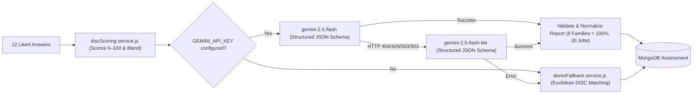

# DISC CareerGuide

**DISC CareerGuide** is a full-stack **MERN + Google Gemini AI** web application that helps users explore career directions through a fast, 12-question DISC work-style self-reflection assessment. It combines a deterministic DISC scoring engine with Gemini Structured Outputs to generate personalized work-style profiles, an 8-family career distribution, 20 matched office and hands-on occupations, and a persistent, guardrailed AI Career Coach.


> [!IMPORTANT]
> **Self-Reflection Notice:** DISC CareerGuide is designed strictly for personal self-reflection and career exploration. It is **not** a scientific diagnostic, clinical instrument, or hiring/candidate-screening tool, and it intentionally refuses to fabricate salary figures or labor market statistics.

---

## Table of Contents

- [DISC CareerGuide](#disc-careerguide)
  - [Table of Contents](#table-of-contents)
  - [Key Features](#key-features)
  - [Tech Stack](#tech-stack)
  - [How It Works](#how-it-works)
    - [Deterministic DISC Scoring Engine](#deterministic-disc-scoring-engine)
    - [Gemini AI Pipeline \& Automatic Demo Fallback](#gemini-ai-pipeline--automatic-demo-fallback)
  - [Project Structure](#project-structure)
  - [Prerequisites](#prerequisites)
  - [Getting Started](#getting-started)
    - [1. Clone the Repository](#1-clone-the-repository)
    - [2. Configure \& Start the Backend (`server`)](#2-configure--start-the-backend-server)
    - [3. Configure \& Start the Frontend (`client`)](#3-configure--start-the-frontend-client)
  - [Environment Variables](#environment-variables)
    - [Backend (`server/.env`)](#backend-serverenv)
    - [Frontend (`client/.env`)](#frontend-clientenv)
  - [Demo Mode (No API Key Required)](#demo-mode-no-api-key-required)
  - [API Reference](#api-reference)
    - [Health](#health)
    - [Authentication (`/api/auth`)](#authentication-apiauth)
    - [Assessments (`/api/assessments`)](#assessments-apiassessments)
    - [AI Career Coach Chat (`/api/chat`)](#ai-career-coach-chat-apichat)
  - [Frontend Routes](#frontend-routes)
  - [Database Models](#database-models)
  - [Available Scripts](#available-scripts)
    - [Backend (`server/`)](#backend-server)
    - [Frontend (`client/`)](#frontend-client)
  - [Production Deployment Notes](#production-deployment-notes)
  - [Troubleshooting](#troubleshooting)

---

## Key Features

- **12-Question Interactive DISC Assessment**
  - Measures all four DISC dimensions (**Dominance**, **Influence**, **Steadiness**, **Conscientiousness**) on a 1–5 Likert scale.
  - Smooth step-by-step animated transitions, clickable progress indicators, and full keyboard shortcut support (`1`–`5` to select, `Enter` / `→` for next, `←` for back).
- **Personalized Results Blueprint**
  - Animated circular SVG score cards for D, I, S, and C (0–100 scale) highlighting primary and secondary traits.
  - Interactive **DISC Radar Chart** (Recharts) and **8-Family Career Fit** distribution normalized to 100%.
  - AI-generated blend title, narrative summary, 3 core strengths, and 2–3 constructive growth areas ("Worth Practising").
  - One-click **Copy Full Report** to clipboard in formatted plain text.
- **20-Role Career & Job Explorer**
  - Displays 20 diverse occupations per assessment—enforcing at least **12 office roles** and **8 hands-on / field roles** across 8 career families.
  - Real-time client-side filtering by keyword (title, description, or skills), office-only toggle, career family, and minimum match percentage slider.
  - **Job Detail Modal** with side-by-side comparison bars pitting your DISC scores against each role's target DISC profile, key skills, an actionable first step, and a deep-link button to ask the AI Coach about that specific role.
- **Guardrailed AI Career Coach**
  - Context-aware multi-turn chat persisted per assessment in MongoDB, grounded in your exact D/I/S/C scores.
  - Built-in starter prompt chips, character counter (up to 1,500 chars), typing indicator, and automatic scrolling.
  - Strict system guardrails keep conversations focused on career exploration, skill planning, and workplace communication—politely declining off-topic, hiring-screening, clinical, or fake-salary requests.
- **Assessment History & Account Security**
  - JWT-based authentication (`bcryptjs` password hashing, token hydration via `/api/auth/me`, and automatic 401 session handling).
  - Revisit past assessments in a responsive bento grid, jump directly to Results, Jobs, or Chat, or permanently delete an assessment along with its linked chat session.
- **Resilient AI with Zero-Key Demo Mode**
  - Automatic model fallback (`gemini-2.5-flash` → `gemini-2.5-flash-lite`) on transient HTTP errors (`404`, `429`, `500`, `503`).
  - Automatic fallback to a rich, deterministic local engine (`demoFallback.service.js`) whenever `GEMINI_API_KEY` is omitted or unreachable, clearly badged as **Demo Mode** in the UI.

---

## Tech Stack

| Layer | Technologies |
| --- | --- |
| **Frontend** | React 18, Vite 6, React Router DOM 6, TanStack React Query 5, Tailwind CSS 3, Framer Motion 12, Recharts 2, Lucide React, React Hot Toast, Axios |
| **Backend** | Node.js (ESM, `>=18`), Express 4, Mongoose 8, Zod 3 (env & request validation), JSON Web Tokens (`jsonwebtoken`), `bcryptjs`, Helmet, CORS, `express-rate-limit` |
| **Database** | MongoDB (local instance or MongoDB Atlas) |
| **AI Integration** | Official Google Gen AI SDK (`@google/genai`) with Structured JSON Outputs (`gemini-2.5-flash` / `gemini-2.5-flash-lite`) + local deterministic fallback |

---

## How It Works

### Deterministic DISC Scoring Engine

Assessment scoring is computed deterministically on the backend in [`server/src/services/discScoring.service.js`](server/src/services/discScoring.service.js) so scores are transparent, reproducible, and independent of LLM variance:

- The 12 answers (integers `1`–`5`) map directly to four 3-question slices:
  - **Dominance (`D`)**: indices `0–2`
  - **Influence (`I`)**: indices `3–5`
  - **Steadiness (`S`)**: indices `6–8`
  - **Conscientiousness (`C`)**: indices `9–11`
- Each dimension is normalized to a `0–100` score:

```text
Score = Math.round((sum_of_3_answers / 15) * 100)
```

- Dimensions are ranked descending (ties broken in `D → I → S → C` order) to determine `primaryTrait`, `secondaryTrait`, and `blendLabel` (e.g., `C / D Blend`).

### Gemini AI Pipeline & Automatic Demo Fallback



1. **Structured Career Reports**: Uses Gemini's JSON `responseSchema` to enforce exact output structure, then validates and normalizes all 8 career families so `matchProbability` integers sum to exactly `100` and all 20 recommended jobs meet the role-diversity rule (`>= 12` office, `>= 8` non-office).
2. **Multi-Turn AI Coach**: Sends the user's DISC scores in the system instruction alongside at most the **last 12 messages** (`MAX_CHAT_HISTORY_MESSAGES = 12`) to keep latency and token costs predictable.
3. **Graceful Degradation**: If `GEMINI_API_KEY` is blank or Gemini requests fail, `demoFallback.service.js` computes Euclidean similarity across 8 career family profiles and 20 curated occupations, and powers intent-aware coaching replies with the same ethical guardrails.

---

## Project Structure

```text
DISC Career Guide/
├── README.md
├── .gitignore
├── client/                                 # React + Vite SPA
│   ├── .env.example                        # Client environment template
│   ├── index.html
│   ├── package.json
│   ├── tailwind.config.js
│   ├── postcss.config.js
│   ├── vite.config.js
│   └── src/
│       ├── main.jsx
│       ├── App.jsx                         # Router & protected route definitions
│       ├── index.css                       # Dark glassmorphism theme utilities
│       ├── api/
│       │   ├── axiosClient.js              # Axios instance, Bearer interceptor & 401 handler
│       │   └── careerApi.js                # Auth, assessment, and chat API functions
│       ├── context/
│       │   └── AuthContext.jsx             # Session state, hydration & localStorage sync
│       ├── data/
│       │   └── discQuestions.js            # 12 DISC statements, Likert options & trait metadata
│       ├── components/
│       │   ├── auth/
│       │   │   └── ProtectedRoute.jsx
│       │   ├── jobs/
│       │   │   ├── JobCard.jsx
│       │   │   ├── JobDetailModal.jsx      # Side-by-side DISC alignment modal
│       │   │   └── JobFilters.jsx          # Search, office toggle, family & match slider
│       │   ├── layout/
│       │   │   ├── Navbar.jsx
│       │   │   └── DisclaimerFooter.jsx
│       │   └── results/
│       │       ├── CareerFamilyChart.jsx   # 8-family horizontal distribution bars
│       │       ├── DiscRadarChart.jsx      # Recharts 4-axis radar visualization
│       │       └── DiscScoreCards.jsx      # Animated SVG ring score cards
│       └── pages/
│           ├── HomePage.jsx
│           ├── LoginPage.jsx
│           ├── RegisterPage.jsx
│           ├── AssessmentPage.jsx
│           ├── ResultsDashboardPage.jsx
│           ├── JobExplorerPage.jsx
│           ├── AiCoachPage.jsx
│           └── HistoryPage.jsx
└── server/                                 # Express + Mongoose REST API
    ├── .env.example                        # Server environment template
    ├── package.json
    └── src/
        ├── server.js                       # Entry point & graceful shutdown (SIGINT/SIGTERM)
        ├── app.js                          # Express app, Helmet, CORS, rate limiter & routes
        ├── config/
        │   ├── env.js                      # Zod-validated environment configuration
        │   └── db.js                       # MongoDB connection lifecycle helpers
        ├── controllers/
        │   ├── auth.controller.js
        │   ├── assessment.controller.js
        │   ├── chat.controller.js
        │   └── health.controller.js
        ├── middlewares/
        │   ├── auth.middleware.js          # JWT Bearer authentication guard
        │   ├── errorHandler.js             # AppError & centralized JSON error handler
        │   ├── rateLimiter.js              # 30 req/min/IP rate limiter on /api
        │   └── validateRequest.js          # Zod body/params validation middleware
        ├── models/
        │   ├── User.model.js
        │   ├── Assessment.model.js
        │   └── ChatSession.model.js
        ├── routes/
        │   ├── index.js
        │   ├── auth.routes.js
        │   ├── assessment.routes.js
        │   ├── chat.routes.js
        │   └── health.routes.js
        ├── services/
        │   ├── discScoring.service.js      # Deterministic 12-question DISC scorer
        │   ├── gemini.service.js           # Gemini Structured Outputs & chat service
        │   └── demoFallback.service.js     # Offline/demo career report & coach engine
        └── validators/
            ├── auth.validator.js
            ├── assessment.validator.js
            └── chat.validator.js
```

---

## Prerequisites

- **Node.js** `v18.0.0` or higher (required for native `node --watch` and ESM support)
- **npm** `v9+`
- **MongoDB** running locally (`mongodb://127.0.0.1:27017`) or a cloud **MongoDB Atlas** connection URI
- **Google Gemini API Key** *(optional)* — get one from [Google AI Studio](https://aistudio.google.com/apikey). The app works fully in **Demo Mode** without a key.

---

## Getting Started

### 1. Clone the Repository

```bash
git clone <your-repository-url>
cd "DISC Career Guide"
```

### 2. Configure & Start the Backend (`server`)

```bash
cd server
npm install
```

Create a `server/.env` file by copying `server/.env.example`:

```bash
# macOS / Linux
cp .env.example .env

# Windows (PowerShell)
Copy-Item .env.example .env
```

Edit `server/.env` with your MongoDB URI, JWT secret, and (optionally) Gemini API key, then start the development server:

```bash
npm run dev
```

The API will be available at `http://localhost:5000/api`. Verify connectivity at `http://localhost:5000/api/health`.

### 3. Configure & Start the Frontend (`client`)

Open a second terminal from the repository root:

```bash
cd client
npm install
```

Create `client/.env` from `client/.env.example`:

```bash
# macOS / Linux
cp .env.example .env

# Windows (PowerShell)
Copy-Item .env.example .env
```

Start the Vite development server:

```bash
npm run dev
```

Open `http://localhost:5173` in your browser, register a new account, and take the 12-question DISC assessment.

---

## Environment Variables

### Backend (`server/.env`)

Validated on startup via Zod in [`server/src/config/env.js`](server/src/config/env.js):

| Variable | Required | Default | Description |
| --- | --- | --- | --- |
| `NODE_ENV` | No | `development` | Runtime environment (`development`, `test`, or `production`). |
| `PORT` | No | `5000` | Port for the Express API server. |
| `MONGO_URI` | No* | `mongodb://127.0.0.1:27017/disc_careerguide` | MongoDB connection string. *Must point to a reachable MongoDB instance. |
| `JWT_SECRET` | Yes (prod) | `change_me_in_production` | Secret key used to sign/verify JWT tokens. Startup throws an error in `production` if left as the default. |
| `JWT_EXPIRES_IN` | No | `7d` | JWT expiration window (e.g., `7d`, `24h`). |
| `GEMINI_API_KEY` | No | `""` | Google Gemini API key. Leave empty to run in local Demo Mode. |
| `GEMINI_MODEL` | No | `gemini-2.5-flash` | Reported Gemini model identifier in `/api/health`. |
| `CLIENT_URL` | No | `http://localhost:5173` | Allowed CORS origin(s). Supports comma-separated URLs for multiple origins (e.g., `http://localhost:5173,https://your-app.com`). |

### Frontend (`client/.env`)

| Variable | Required | Default | Description |
| --- | --- | --- | --- |
| `VITE_API_URL` | No | `http://localhost:5000/api` | Base URL for backend API requests. |

---

## Demo Mode (No API Key Required)

If you want to evaluate or develop the application without configuring a Gemini API key:

1. Leave `GEMINI_API_KEY=` blank in `server/.env`.
2. Start the backend and frontend normally.
3. All assessments will be scored deterministically and enriched using [`server/src/services/demoFallback.service.js`](server/src/services/demoFallback.service.js), generating a tailored blend report, 8 normalized career families, 20 ranked roles (12 office / 8 field), and guardrailed coaching responses.
4. Reports and chats generated via fallback are flagged with `isDemoFallback: true` / `isDemo: true` and display a **Demo Mode** badge in the UI.

---

## API Reference

All endpoints are mounted under `/api` and protected by a rate limiter (**30 requests per minute per IP**, returning HTTP `429` when exceeded).

Protected endpoints require an `Authorization: Bearer <token>` header.

### Health

| Method | Endpoint | Auth | Description |
| --- | --- | --- | --- |
| `GET` | `/api/health` | Public | Returns API status, MongoDB connection state (`dbConnected`), AI provider, model, and whether `GEMINI_API_KEY` is configured (`aiConfigured`). |

### Authentication (`/api/auth`)

| Method | Endpoint | Auth | Request Body / Notes |
| --- | --- | --- | --- |
| `POST` | `/api/auth/register` | Public | `{ "name": "Alex Rivera", "email": "alex@example.com", "password": "password123" }` — Name: 2–60 chars; Password: 8–128 chars. Returns `{ token, user }` (`201`). |
| `POST` | `/api/auth/login` | Public | `{ "email": "alex@example.com", "password": "password123" }` — Returns `{ token, user }` (`200`). |
| `GET` | `/api/auth/me` | Bearer JWT | Returns the authenticated user `{ user: { _id, name, email } }` (`200`). |

### Assessments (`/api/assessments`)

| Method | Endpoint | Auth | Request Body / Notes |
| --- | --- | --- | --- |
| `POST` | `/api/assessments` | Bearer JWT | `{ "answers": [4, 5, 4, 3, 2, 3, 4, 4, 3, 5, 5, 4] }` — Exactly 12 integers (`1`–`5`). Scores DISC traits, generates the AI (or demo) career report, saves to MongoDB, and returns `{ assessment }` (`201`). |
| `GET` | `/api/assessments` | Bearer JWT | Lists the current user's saved assessments (newest first) with summary fields (`_id`, `scores`, `blendLabel`, `aiReport.styleTitle`, `isDemoFallback`, `createdAt`). |
| `GET` | `/api/assessments/:id` | Bearer JWT | Fetches a full assessment by MongoDB ObjectId (verifies user ownership). |
| `DELETE` | `/api/assessments/:id` | Bearer JWT | Deletes an owned assessment and cascades deletion to its linked `ChatSession` documents. |

### AI Career Coach Chat (`/api/chat`)

| Method | Endpoint | Auth | Request Body / Notes |
| --- | --- | --- | --- |
| `POST` | `/api/chat` | Bearer JWT | `{ "assessmentId": "<24-char-objectId>", "message": "Which office roles best fit my blend?" }` — Message: 1–1,500 chars. Persists both turns and returns `{ reply, sessionId, isDemo }` (`200`). |
| `GET` | `/api/chat/:assessmentId` | Bearer JWT | Returns persisted chat history `{ assessmentId, sessionId, messages }` for an owned assessment. |

---

## Frontend Routes

| Route | Access | Page Component | Purpose |
| --- | --- | --- | --- |
| `/` | Public | `HomePage` | Landing page introducing DISC CareerGuide and the four DISC styles. |
| `/login` | Public | `LoginPage` | Sign in with email and password. |
| `/register` | Public | `RegisterPage` | Create a new user account. |
| `/test` | Protected | `AssessmentPage` | 12-question interactive DISC assessment with keyboard navigation. |
| `/history` | Protected | `HistoryPage` | View, reopen, or delete past assessments. |
| `/results/:id` | Protected | `ResultsDashboardPage` | DISC score cards, radar chart, 8-family fit chart, narrative profile, top 4 jobs, and plain-text copy. |
| `/jobs/:id` | Protected | `JobExplorerPage` | Filterable 20-role explorer with side-by-side DISC comparison modal. |
| `/chat/:id` | Protected | `AiCoachPage` | Persistent, DISC-grounded AI Career Coach chat. |

---

## Database Models

- **`User`** (`server/src/models/User.model.js`)
  - `name`, unique lowercased `email`, and `bcryptjs`-hashed `password` (`select: false` by default, stripped in `toJSON`).
- **`Assessment`** (`server/src/models/Assessment.model.js`)
  - References `userId`, stores `answers` (12 numbers), `scores` (`{ D, I, S, C }`), `primaryTrait`, `secondaryTrait`, `blendLabel`, embedded `aiReport` (`styleTitle`, `summary`, `strengths`, `growthAreas`, `careerFamilies`, `recommendedJobs`), and `isDemoFallback`.
- **`ChatSession`** (`server/src/models/ChatSession.model.js`)
  - Indexed by `{ userId, assessmentId }`, storing chronological `messages` (`role: 'user' | 'model'`, `content`, `createdAt`).

---

## Available Scripts

### Backend (`server/`)

| Command | Description |
| --- | --- |
| `npm run dev` | Starts the Express server in watch mode (`node --watch src/server.js`). |
| `npm start` | Starts the Express server for production (`node src/server.js`). |

### Frontend (`client/`)

| Command | Description |
| --- | --- |
| `npm run dev` | Launches the Vite dev server on port `5173`. |
| `npm run build` | Builds the optimized production bundle into `client/dist/`. |
| `npm run preview` | Locally previews the production build from `client/dist/`. |

---

## Production Deployment Notes

1. **Backend Environment**:
   - Set `NODE_ENV=production`.
   - Set a strong, unique `JWT_SECRET` (the server refuses to boot in production with the placeholder secret).
   - Set `MONGO_URI` to your managed MongoDB cluster (e.g., MongoDB Atlas).
   - Set `CLIENT_URL` to your deployed frontend origin(s), comma-separated if hosting multiple domains.
   - Provide `GEMINI_API_KEY` to enable live Gemini 2.5 Flash responses.
2. **Frontend Build**:
   - Set `VITE_API_URL` to your deployed backend URL ending in `/api` (e.g., `https://api.yourdomain.com/api`).
   - Run `npm run build` inside `client/` and deploy the generated `client/dist/` directory to any static host (Vercel, Netlify, Cloudflare Pages, Nginx, etc.) with SPA fallback routing to `index.html`.

---

## Troubleshooting

- **MongoDB fails to connect on startup**: Ensure the local `mongod` service is running or that your `MONGO_URI` (and Atlas IP allowlist) is valid. Check `/api/health` to confirm `"dbConnected": true`.
- **CORS errors in the browser**: Verify `CLIENT_URL` in `server/.env` exactly matches the origin in your browser's address bar (scheme + host + port, no trailing slash).
- **Reports show a "Demo Mode" badge even with a key set**: Check server console logs for `[Gemini]` warnings—this occurs if `GEMINI_API_KEY` is invalid, missing quota, or temporarily unavailable across both `gemini-2.5-flash` and `gemini-2.5-flash-lite`.
- **HTTP `429 Too Many Requests`**: The API enforces a limit of 30 requests per minute per IP (`server/src/middlewares/rateLimiter.js`). Wait one minute before retrying.
